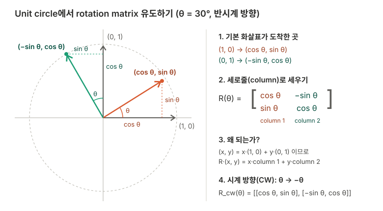
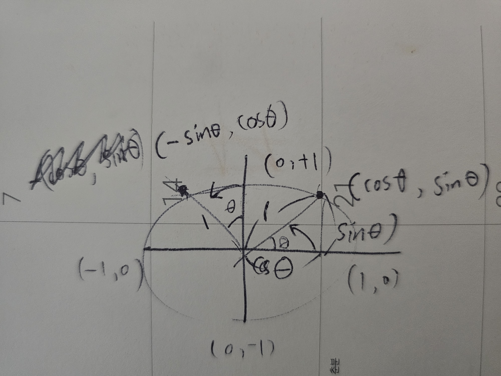

# TIL 2026-11-25

## Done
- `.py` file이 robot을 움직이기까지의 전체 pipeline 이해
- G-code, library location, FK/IK, numpy concept 정리
- Learning log 방식 결정 (TIL daily + WIL weekly)
- Git setup, GitHub push, README roadmap 작성
- FK ground truth data collection (`collect_data.py` → `data/fk_samples.csv`)
- Data로 Mirobot link length 역산
- Unit circle로 rotation matrix를 직접 유도
- `fk_planar.py` 구현: robot data 대비 error **0.01 mm** ✅

## Learned

### Python code가 robot을 움직이는 pipeline
1. Python이 `arm.set_tool_pose(200, 20, 230)` 실행
2. Library가 G-code string으로 변환 (e.g. `M20 G90 G0 X200 Y20 Z230 A0 B0 C0`)
3. pyserial이 string을 byte로 바꿔 USB serial port로 전송
4. CH340 chip이 USB signal을 UART serial signal로 변환
5. Robot firmware가 G-code를 parse하고 IK로 joint angle 계산 → motor 구동
6. Robot이 `ok`와 current status를 response → library가 `Pose` object로 변환

Key point: **무거운 computation (IK, motor control)은 robot controller에서, PC는 "어디로 가"라는 command만 보냄.** Industrial robot도 같은 architecture.

### G-code
- Machine에게 motion을 지시하는 text-based command language (1950년대 CNC machine에서 시작)
- 3D printer, CNC, laser cutter, Mirobot 등에서 사용
- Syntax: letter + number, 한 line = command 하나
  - `G`: motion (G0 rapid move, G1 linear move, G90 absolute coordinate, G91 relative coordinate)
  - `M`: miscellaneous function (Mirobot: M20 Cartesian mode, M21 joint mode)
  - `X Y Z`: position / `A B C`: rotation / `F`: feed rate (speed)
  - `$H`: homing
- Industrial robot은 vendor-specific language 사용 (FANUC KAREL, ABB RAPID 등)

### Library는 어디에?
- Robot이 아니라 **내 Mac의 virtual environment 안**: `.venv/lib/python3.9/site-packages/wlkata_mirobot/`
- `pip install`이 PyPI에서 download해서 install
- Role 분담: Mac (library) = translation + transmission / Robot (firmware) = computation + execution
- VS Code에서 `Cmd+Click`으로 library source code를 직접 열어볼 수 있음

### FK (Forward Kinematics)
- **Joint angle → end-effector position**을 계산
- 2-link planar arm example:
  ```
  x = L1·cos(θ1) + L2·cos(θ1 + θ2)
  y = L1·sin(θ1) + L2·sin(θ1 + θ2)
  ```
- Mirobot은 6-joint라서 3D에서 rotation matrix / homogeneous transformation matrix를 6번 곱함

### IK (Inverse Kinematics)
- **End-effector position → joint angle**을 계산
- Solution이 여러 개이거나 없을 수 있어서 FK보다 어려움
- `set_tool_pose()` call 시 robot firmware 내부에서 IK 계산

### numpy
- Python의 vector / matrix computation library
- Matrix multiplication: `A @ v`, trigonometric function: `np.cos()`, `np.sin()`
- Robotics, computer vision (OpenCV도 image를 numpy array로 처리), machine learning의 기본 tool

### Learning log 방식
- **TIL (Today I Learned)**: daily 10분, raw note
- **WIL (Weekly I Learned)**: weekly로 TIL을 review하고 glossary / concept doc / troubleshooting으로 정리
- Location: project repository의 `docs/` folder

### Mirobot의 6 joints
- **Bend (pitch) joint**: J2 (shoulder), J3 (elbow), J5 (wrist pitch) → 팔을 앞뒤로 숙임
- **Twist joint**: J1 (base, z-axis), J4 (forearm roll), J6 (tool roll)
- 6개인 이유: position 3 + orientation 3 = 6-DoF를 모두 control하려면 최소 6개 joint 필요
- 대략 J1~J3 = 손을 "어디에" 둘지, J4~J6 = 손을 "어느 방향으로" 향할지

### Data에서 robot geometry 역산 (kinematic calibration)
Joint 하나씩 움직인 data로 회전 중심을 거꾸로 계산해서 link length를 구함:

| Link | From → To | x (forward) | z (up) |
|---|---|---|---|
| J2_POS | origin → J2 | 29.69 | 127 |
| UPPER_ARM | J2 → J3 | 0 | 108 |
| FOREARM | J3 → J5 | 168.98 | 20 |
| TOOL | J5 → tool tip | 0 | −24.27 |

- Home check: x = 29.69 + 168.98 = 198.67, z = 127 + 108 + 20 − 24.27 = 230.73 → robot report와 일치
- Sign convention: x right, z up으로 그렸을 때 J2, J3, J5의 + 방향 = clockwise (팔이 앞으로 숙여짐)

### Matrix
- 숫자를 row × column 직사각형으로 배치한 것
- Robotics에서는 vector를 다른 vector로 바꾸는 "transform machine"
- Matrix × vector = 각 row와 vector를 짝끼리 곱해서 더하기
  ```
  [a  b]   [x]   [a·x + b·y]
  [c  d] × [y] = [c·x + d·y]
  ```
- numpy에서는 `@` operator

### Unit circle과 cos / sin
- Radius 1인 circle에서 angle θ 위치의 점 = **(cos θ, sin θ)**
- 즉 x coordinate가 cos θ, y coordinate가 sin θ (hypotenuse = 1인 직각삼각형의 밑변과 높이)
- Radius r이면 (r·cos θ, r·sin θ) → J1 rotation 계산과 같음 (r = 198.67)

### Rotation matrix 유도


1. (1, 0)을 θ만큼 CCW rotation → **(cos θ, sin θ)**
2. (0, 1)은 이미 90° 위치 → 90° + θ로 이동 → **(−sin θ, cos θ)**
   - 왼쪽 위 영역이라 x가 negative
   - 직각삼각형이 90° 돌아서 가로/세로 변이 자리를 바꿈
3. 두 결과를 **column**으로 세우면 rotation matrix:
   ```
   R(θ) = [cos θ  −sin θ]
          [sin θ   cos θ]
   ```
4. 왜 되는가: (x, y) = x·(1, 0) + y·(0, 1)이므로 R·(x, y) = x·column1 + y·column2
5. Clockwise (CW)는 θ → −θ: `[[cos θ, sin θ], [−sin θ, cos θ]]` → `fk_planar.py`의 `rot_cw()`

Key point: **Matrix의 각 column = 기본 화살표가 도착한 곳.** 외우지 않고 언제든 다시 유도 가능.

손으로 그린 note:



### Planar FK = 화살표 이어 붙이기
```
tool tip = J2_POS
         + R(j2)      @ UPPER_ARM
         + R(j2 + j3) @ FOREARM
         + R(j2 + j3) @ TOOL
```
- 각 link vector를 "그때까지 누적된 rotation"만큼 돌려서 더함
- Elbow(J3)보다 앞에 있는 link만 J3 rotation을 받음 → angle이 j2 + j3로 누적
- 이 누적 구조를 3D로 일반화한 것이 4x4 homogeneous transformation matrix의 곱

## Troubleshooting
1. **Data가 target angle과 다르게 기록됨** (J1 30° 명령 → 15.777° 기록)
   - Cause: SDK의 `wait_idle`이 command 직후, robot이 출발하기 전의 "Idle" status를 보고 바로 return (**race condition**)
   - Fix: `wait_until_reached()` 추가 → "state == Idle" + "angle이 target과 0.1° 이내"일 때만 진행
   - Lesson: "ok" response ≠ motion 완료
2. **`portfolio_tips.md`가 GitHub에 올라감**
   - Fix: `.gitignore`에 추가 + `git rm --cached` + `git commit --amend` + `git push --force`
   - Lesson: `git rm --cached`는 local file은 남기고 tracking만 해제. `--force`는 혼자 쓰는 새 repo에서만 조심해서 사용

## Next
- `fk_planar.py` 정리 (dead code, TODO 제거) 후 commit
- Step 1-3: 6-axis FK로 확장 (3D rotation matrix, 4x4 homogeneous transformation)
